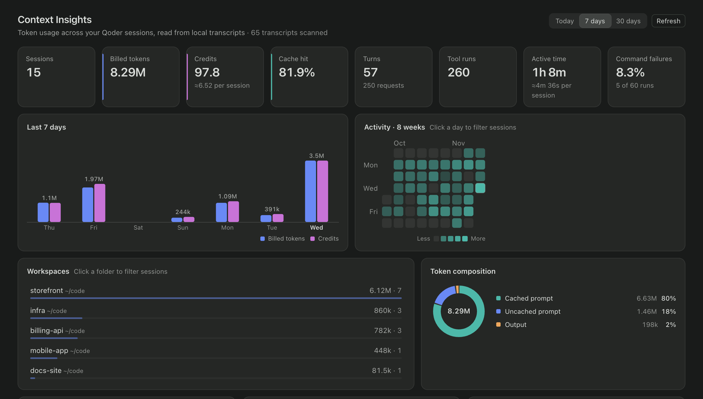
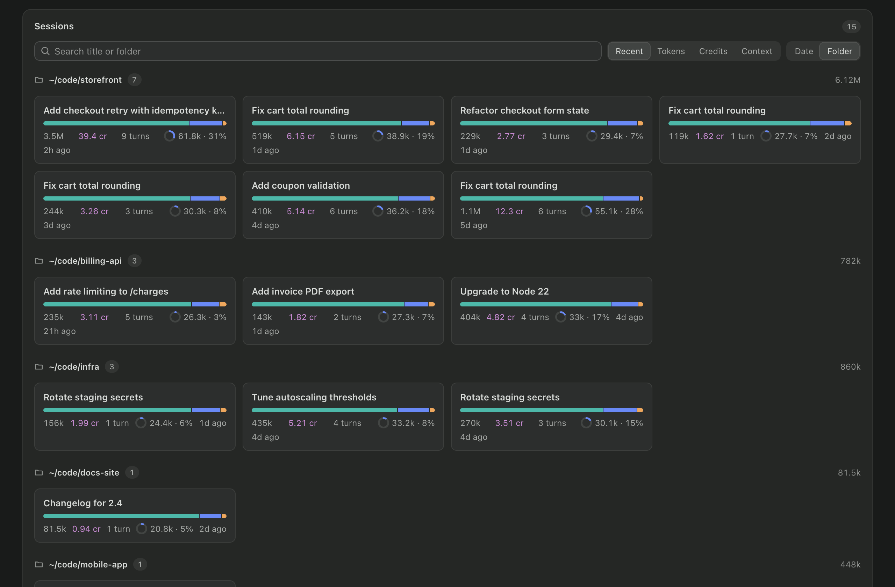
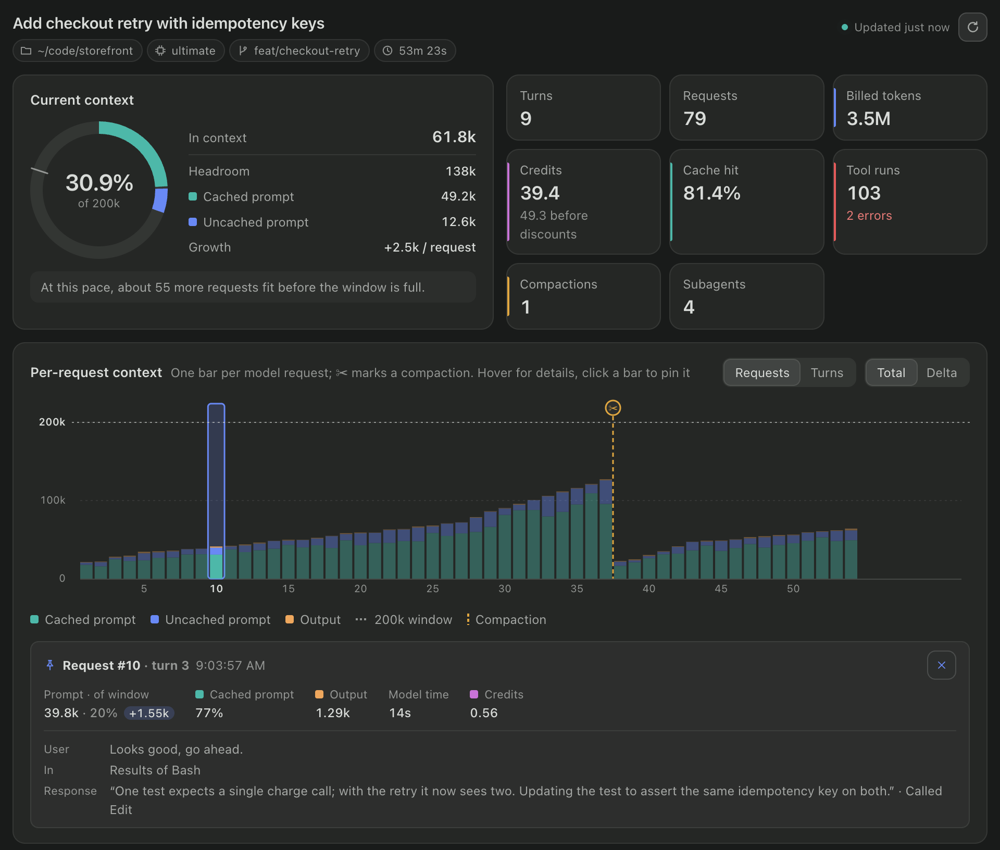
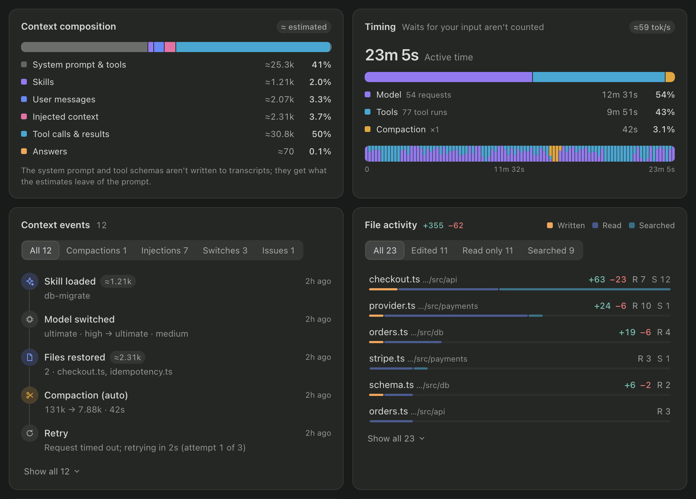
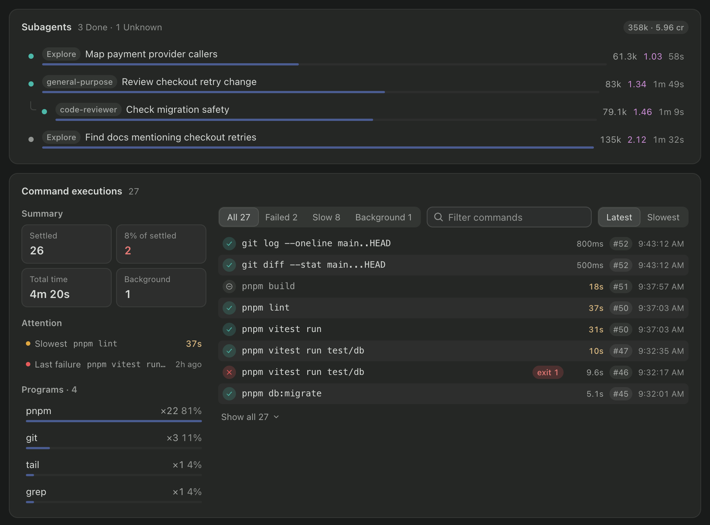

<h1 align="center">qoder-context</h1>

<p align="center">A Qoder Desktop plugin that shows where your tokens and credits go: across every session, and inside
each conversation's context window.</p>

<p align="center"></p>

## Features

- **Context Insights:** sessions, billed tokens, credits, cache-hit rate, turns, tool runs, active time and failed
  commands for today, 7 days or 30 days
- **Activity:** a 7-day chart of tokens and credits, and an 8-week heatmap; click a day to filter the sessions
- **Workspaces:** tokens, credits, sessions and active time per project folder
- **Tallies:** the tools, skills and shell commands used most, and when each was last used
- **Session cards:** searchable, grouped by date or folder, sortable by recency, tokens, credits or context fill;
  click one to open the session in Qoder
- **Context ring:** how full the window is, cached and uncached prompt, growth per request, and how many more
  requests fit
- **Trend:** one bar per request or turn with compactions marked; pin a bar to see what came in and what the reply
  said
- **Composition and timing:** what the window holds (system prompt, skills, messages, tool results), and active
  time split into model, tool and compaction time
- **Context events:** compactions, loaded skills, memories, hook output, MCP tools, model switches, plan mode,
  retries and errors
- **File activity:** lines added and removed per file, and the files read and searched
- **Models and subagents:** requests, tokens and credits per model, and the session's agents as a tree with their
  status and final report
- **Command executions:** every shell run with its outcome, exit code and duration, filterable by failed, slow or
  background
- **Fits in:** English and Simplified Chinese, Qoder's light and dark themes, and keyboard-navigable charts

See [docs/FEATURES.md](docs/FEATURES.md) for the details, [docs/ARCHITECTURE.md](docs/ARCHITECTURE.md) for where the
numbers come from and how fast they load, and [CONTRIBUTING.md](CONTRIBUTING.md) to build and test the plugin.

## Tour

<table>
  <tr>
    <td width="50%"><b>Sessions</b>: search, sort and group every session, here by folder<br>
      <a href="docs/screenshots/insights-sessions.png"></a></td>
    <td width="50%"><b>Session context</b>: the window's fill, and a trend with a request pinned<br>
      <a href="docs/screenshots/session.png"></a></td>
  </tr>
  <tr>
    <td><b>Composition, timing and events</b>: what fills the window, where the time went, and what was injected<br>
      <a href="docs/screenshots/session-composition.png"></a></td>
    <td><b>Subagents and commands</b>: the agent tree, and every shell run with its outcome<br>
      <a href="docs/screenshots/session-agents-commands.png"></a></td>
  </tr>
</table>

Screenshots use synthetic sessions from `scripts/demo-data.mjs`.

## Installation

Requires Qoder Desktop 0.5 or later and Node.js 22 or later to build. The plugin isn't in a plugin store, so Qoder
loads it as an unverified plugin. From a clone of this repository:

```sh
npm install && npm run build
QODER_APP_PLUGIN_ALLOW_UNVERIFIED=true QODER_APP_PLUGIN_DEV_DIRS=$PWD \
  /Applications/Qoder.app/Contents/MacOS/Qoder
```

Open **Context Insights** from the lower-left sidebar. In a conversation, open the Task Monitor and click
**Context** to see that session.

See [CONTRIBUTING.md](CONTRIBUTING.md) to run it in a dev Qoder or preview the views in a browser.

## How it works

Qoder's plugin API doesn't expose token usage, so the plugin reads qodercli's transcripts from
`~/.qoder/projects/` (`~/.qoder-cn` for Qoder CN), read-only and on your machine. Nothing is sent anywhere.

Credits are what each request reported, not a bill, and the context composition is an estimate. Sessions on a
remote SSH host aren't shown. See [docs/ARCHITECTURE.md](docs/ARCHITECTURE.md) for the full list of limits.

## Credits

Inspired by [dsh-context](https://github.com/bowenliang123/dsh-context) by Bowen Liang, the context and token
insight plugin for DeepSeek Harness.

## License

[MIT](LICENSE)
